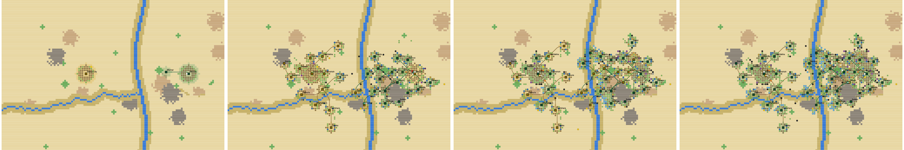

<p align="center">
  
</p>

<h1 align="center">Rich vs Smart · الأثرياء ضد الأذكياء</h1>

<p align="center">
  <b>Two kingdoms, one map, up to 1,000 years. One has the gold, the other has the brains. Who wins?</b><br>
  <b>مملكتان، خريطة واحدة، حتى ألف سنة. واحدة عندها الذهب، والثانية عندها العقل. من يفوز؟</b>
</p>

<p align="center">
  
  
  
  
</p>

<p align="center">
  <a href="#ar"><b>العربية</b></a> &nbsp;·&nbsp; <a href="#en"><b>English</b></a> &nbsp;·&nbsp; <!-- VIDEO_LINK --> <a href="#video">Video / الفيديو</a>
</p>

<p align="center">
  <br>
  <sub>Year 0 → 186 → 318 → 555 of the film's story (seed 132) · السنة 0 ← 186 ← 318 ← 555 من قصة الفيلم</sub>
</p>

---

<a name="ar"></a>

<div dir="rtl" align="right">

## العربية

### ما هذا؟

هذه هي المحاكاة الكاملة وراء فيديو **«مملكة الأثرياء الأغبياء ضد مملكة الفقراء الأذكياء»**. كود بايثون واحد، بدون أي مكتبات إضافية، وبدون أي ذكاء اصطناعي: تشغّله على جهازك وتشوف نفس التاريخ اللي في الفيلم بالضبط، أو تجرّب بذور (seeds) جديدة وتشوف تواريخ جديدة.

مملكتان على نفس الخريطة (160×100 مربع، نهر، واحات، جبال، بحر)، كل وحدة تبدأ بـ 20,000 نسمة:

| | مملكة الأثرياء | مملكة الفقراء |
|---|---|---|
| الذهب في البداية | **30,000** | **2,000** |
| سرعة البحث والاختراع | **×0.3** | **×1.0** |
| ميزتها | ذهب، إيجار أراضي، مرتزقة | اختراعات، تكتيك، كمائن |

### القواعد بكلام بسيط

- **الذهب يشتري مرتزقة:** كل جيش جديد للأثرياء يقدر يضيف **8,000 مرتزق كحد أقصى** (400 وحدة × 20 رجل)، ويدفع لهم من خزينته (حتى 15% منها في المرة، وفقط إذا الخزينة 1,500 ذهب أو أكثر). المرتزقة لهم رواتب سنوية، وإذا ما انصرف لهم يهربون.
- **عدد الجيوش محدود:** وقت الحرب، أقصى عدد جيوش = **2 + جيش لكل 3 مدن**. يعني الذهب وحده ما يكفي، تحتاج مدن.
- **العقل يحسّن القتال أيضاً:** نفس معامل الذكاء يدخل في التكتيك (قوة × (0.7 + 0.3 × الذكاء))، والفقراء يقدرون ينصبون كمائن.
- **الجواسيس:** الأثرياء يقدرون يسرقون اختراعات الفقراء، لكن الاختراع المسروق **ما يصير قابل للاستخدام إلا بعد 5 إلى 10 سنوات**، والجاسوس ممكن ينمسك (والتوتر يرتفع).
- **الحرب:** التوتر يتجمع من حوادث الحدود والخلافات على الموارد، ولما يتجاوز 4.0 ممكن تبدأ الحرب. بعدها هدنات وحروب جديدة.
- **العاصمة:** إذا سقطت العاصمة، تُبنى عاصمة جديدة في أكبر مدينة **بعد 15 سنة**، بشرط يكون عند المملكة **3 مدن أو أكثر**.
- **النهاية:**
  - **غزو:** مملكة ما بقى عندها ولا مدينة.
  - **انهيار:** بدون عاصمة + أقل من مدينتين + سكانها أقل من **10%** من سكان خصمها، لمدة **5 سنوات متتالية**.
  - **انتهاء الوقت:** عند السنة 1000 يفوز صاحب أعلى نقاط (السكان + 1,500 لكل مدينة + 300 لكل تقنية).

### تشغيل سريع

تحتاج فقط Python 3.9 أو أحدث (موجود أصلاً في macOS و Linux):

```bash
git clone https://github.com/khalidx199/rich-vs-smart-sim.git
cd rich-vs-smart-sim
python3 sim.py run --seed 7
```

يطبع ملخص التاريخ كامل: من فاز، في أي سنة، كم حرب، كم مدينة سقطت، كم اختراع انسرق… جرّب أي رقم بدل 7.

### إعادة قصة الفيلم (البذرة 132)

```bash
./run_film_story.sh
```

يشغّل المحاكاة بالبذرة 132 ويكتب `story/` و `maps/`، ثم يتأكد إن النتيجة **مطابقة حرفياً** للنسخة المنشورة في `samples/story_seed132/` (يستغرق ثواني). أبرز اللحظات:

| السنة | ماذا حدث |
|---|---|
| 9 | الفقراء يخترعون الآبار |
| 31 | دخل الفقراء يتجاوز دخل الأثرياء (123 مقابل 120 ذهب في السنة) |
| 72 | تلتقي حدود المملكتين |
| 80 | أول حرب، وأول 8,000 مرتزق |
| 136 | الأثرياء يسرقون سر طاحونة الهواء |
| 151 | الطاعون |
| 186 | ذروة الأثرياء: عاصمة الفقراء تسقط، وفي نفس السنة الفقراء يخترعون المنجنيق |
| 555 | انهيار مملكة الأثرياء: مدينة واحدة مقابل 37 للفقراء |

القائمة الكاملة: [`samples/story_seed132/key_moments.md`](samples/story_seed132/key_moments.md).

### النتائج

**200 تاريخ مختلف (البذور 1 إلى 200):**

| الفائز | العدد | النسبة |
|---|---|---|
| الفقراء الأذكياء | 139 | **70%** |
| الأثرياء الأغبياء | 61 | **30%** |

**هل يكفي ذهب أكثر؟** (60 بذرة لكل إعداد)

| ذهب الأثرياء | فوز الأثرياء |
|---|---|
| ×0.5 | 25% |
| ×1 (الأصلي) | 25% |
| ×2 | 33% |
| ×4 | 35% |
| ×8 | 33% |
| ×16 | 33% |

**لكن الحد الأقصى للمرتزقة يغيّر كل شي:**

| حد المرتزقة لكل جيش | فوز الأثرياء |
|---|---|
| 2,000 | 7% |
| 8,000 (الأصلي) | 25% |
| 32,000 | 85% |

ضاعف الذهب 16 مرة وما يتغيّر شي تقريباً، لأن الذهب ما يتحوّل لجنود أكثر. ارفع حد المرتزقة، وفجأة الأثرياء يفوزون.

<details>
<summary><b>تشغيل التجارب كاملة بنفسك</b></summary>

```bash
python3 sim.py batch              # 200 تاريخ -> batch/summary.txt (حوالي 4 دقائق)
python3 sim.py batch --quick      # 8 تواريخ فقط (حوالي 15 ثانية)
python3 sweep/run_sweep.py run    # 17 إعداد × 60 بذرة = 1,020 تشغيل (حوالي 20 دقيقة)
python3 sweep/run_sweep.py summarize
```

التشغيل يستخدم 4 عمليات متوازية (multiprocessing). الأوقات مقاسة على Mac بمعالج Apple Silicon.
</details>

<details>
<summary><b>الملفات الناتجة</b></summary>

- `story/state.json`: كل سنة بالتفصيل (السكان، الذهب، المدن، المباني، الجيوش، المعارك). الصيغة موثّقة في [FORMAT.md](FORMAT.md).
- `story/log.txt`: سجل الأحداث المهمة سطر بسطر.
- `story/key_moments.md`: أهم اللحظات مع شرح ليش هي مهمة.
- `maps/map_YYYY.svg`: خرائط للسنوات المفصلية.
- `batch/runs.csv` و `batch/summary.txt`: نتائج الـ 200 تاريخ.
</details>

### الفيديو

<!-- VIDEO_LINK -->
قريباً.

### الترخيص

MIT © خالد عبدالجليل. استخدمه، عدّله، وشاركه بحرية.

</div>

---

<a name="en"></a>

## English

### What is this?

This is the complete simulation behind the video **"The Kingdom of the Rich Fools vs the Kingdom of the Smart Poor"**. One Python file, no dependencies, **no AI involved**: run it on your machine and get exactly the history shown in the film, or try new seeds and watch new histories unfold.

Two kingdoms share one map (160×100 tiles with a river, oases, mountains and a coast). Each starts with 20,000 people:

| | Rich kingdom | Poor kingdom |
|---|---|---|
| Starting gold | **30,000** | **2,000** |
| Research speed | **×0.3** | **×1.0** |
| Strength | gold, land rent, mercenaries | inventions, tactics, ambushes |

### The rules in plain words

- **Gold buys mercenaries:** each new rich army can add **at most 8,000 mercenaries** (400 units × 20 men), paid from the treasury (up to 15% of it per hire, and only with at least 1,500 gold). Mercenaries draw yearly upkeep and desert when unpaid.
- **The number of armies is capped:** at war, a kingdom can field at most **2 armies + 1 per 3 cities**. Gold alone is not enough; you need cities.
- **Brains help in battle too:** the same intelligence factor feeds tactics (power × (0.7 + 0.3 × intelligence)), and the poor can set ambushes.
- **Spies:** the rich can steal the poor's inventions, but a stolen technology only becomes **usable 5 to 10 years later**, and spies can be caught (raising tension).
- **War:** tension builds from border incidents and resource disputes; above 4.0 a war can break out. Truces and new wars follow.
- **Capitals:** when a capital falls, a new one is set up in the largest city **after 15 years**, only if the kingdom still has **3 or more cities**.
- **How it ends:**
  - **Conquest:** a kingdom has no cities left.
  - **Collapse:** no capital, fewer than 2 cities and a population below **10%** of the rival's, for **5 years in a row**.
  - **Time limit:** at year 1,000 the higher score wins (population + 1,500 per city + 300 per technology).

Every number above is a named constant at the top of [`sim.py`](sim.py) (`START_GOLD`, `INTEL`, `MERC_MAX`, `ARMY_CAP_BASE`, `ADOPT_MIN`/`ADOPT_MAX`, `CAPITAL_REBUILD`, ...).

### Quick start

All you need is Python 3.9 or newer (already on macOS and most Linux systems):

```bash
git clone https://github.com/khalidx199/rich-vs-smart-sim.git
cd rich-vs-smart-sim
python3 sim.py run --seed 7
```

This prints the summary of one full history: who won, in which year, how many wars, captured cities, stolen inventions and more. Any number works as a seed. One run takes about 2–3 seconds.

### Reproduce the film's story (seed 132)

```bash
./run_film_story.sh
```

It runs seed 132, writes `story/` and `maps/`, and then checks that the result is **identical** to the published copy in `samples/story_seed132/` (takes a few seconds). Highlights:

| Year | What happens |
|---|---|
| 9 | The poor invent wells |
| 31 | The poor now out-earn the rich (123 vs 120 gold a year) |
| 72 | First contact: the borders meet |
| 80 | First war, and the first 8,000 mercenaries are hired |
| 136 | Rich spies steal the secret of the windmill |
| 151 | Plague |
| 186 | The rich peak: the poor capital falls, and the same year the poor invent the trebuchet |
| 555 | The rich kingdom collapses: 1 city left against the poor's 37 |

Full list: [`samples/story_seed132/key_moments.md`](samples/story_seed132/key_moments.md).

### Results

**200 different histories (seeds 1–200):**

| Winner | Runs | Share |
|---|---|---|
| Smart Poor | 139 | **70%** |
| Rich Fools | 61 | **30%** |

<details>
<summary>More batch statistics</summary>

From [`samples/batch/summary.txt`](samples/batch/summary.txt):

- End reasons: collapse 69, conquest 74, time limit 57.
- First war on average in year 58; 192 of 200 runs have a war; 10.3 wars per run.
- Inventions per run: rich 10.9, poor 14.7. Theft attempts per run 3.1, of which 1.6 succeed.
- The rich are ahead at some point in 133 of 200 runs, and the lead changes 3.4 times per run.
</details>

**Does more gold help?** (60 seeds per setting, paired by seed)

| Rich starting gold | Rich win rate |
|---|---|
| ×0.5 | 25% |
| ×1 (default) | 25% |
| ×2 | 33% |
| ×4 | 35% |
| ×8 | 33% |
| ×16 | 33% |

**But the mercenary cap changes everything:**

| Mercenary cap per army | Rich win rate |
|---|---|
| 2,000 | 7% |
| 8,000 (default) | 25% |
| 32,000 | 85% |

Multiply the gold by 16 and almost nothing changes, because gold does not turn into more soldiers. Raise the mercenary cap, and suddenly the rich win. The full table (confidence intervals, end types, army sizes, unspent gold) is in [`samples/sweep/sweep_summary.md`](samples/sweep/sweep_summary.md).

<details>
<summary><b>Run the full experiments yourself</b></summary>

```bash
python3 sim.py batch              # 200 histories -> batch/runs.csv, batch/summary.txt   (~4 min)  
python3 sim.py batch --quick      # 8 histories only                                     (~15 s)
python3 sim.py search             # score seeds 1–240 for story drama -> story/search.csv (~4–5 min)
python3 sweep/run_sweep.py run    # 17 settings × 60 seeds = 1,020 runs -> sweep/        (~20 min)  
python3 sweep/run_sweep.py summarize
```

- Batch, search and sweep use Python's `multiprocessing` with **4 worker processes** (`POOLS = 4` in `sim.py`, `Pool(4)` in `run_sweep.py`). Prefix with `nice -n 10` to keep your machine responsive.
- Times measured on an Apple Silicon Mac: one run ≈ 2.5 s, `export` ≈ 5 s, `batch --quick` ≈ 16 s; the full 200-run batch ≈ 3.7 min; the 1,020-run sweep ≈ 20 min (estimated from the batch).
- The sweep never edits `sim.py`: it imports it and overrides constants (`START_GOLD`, `MERC_MAX`, `MERC_GOLD_SHARE`, `ARMY_MAX`, `ARMY_CAP_BASE`, `RECRUIT_P`) inside each worker. Pick settings with `--settings gold_x2,merc_max_1600` and seeds with `--seeds 1-60`.
- The simulation is deterministic: the same seed always gives the same history.
</details>

<details>
<summary><b>Commands and output files</b></summary>

| Command | What it does |
|---|---|
| `python3 sim.py run --seed N` | one history, summary printed |
| `python3 sim.py batch [--quick]` | many histories, writes `batch/` |
| `python3 sim.py search [--quick]` | ranks seeds by how eventful their story is, writes `story/search.csv` |
| `python3 sim.py export --seed 132` | full story export: `story/` and `maps/` (used by `run_film_story.sh`) |
| `python3 quick_check.py` | 58 sanity and identity checks on `story/` |

Output files:

- `story/state.json`: every simulated year in full (population, gold, cities, buildings, roads, armies, battles, sieges). Format: [FORMAT.md](FORMAT.md).
- `story/log.txt`: the logged events, one line each. `story/key_moments.md`: the highlights, with why each matters.
- `maps/map_YYYY.svg`: map snapshots at key years.
- `batch/runs.csv`, `batch/summary.txt`: per-run rows and the batch summary.

Note: the `export` command includes a display layer (`export_v5.py`) written for the film's story; it reads the hand-made city and era names in `story/names_v2.json` and `story/periods_v2.json` (copied there by `run_film_story.sh`). For other seeds use `run`, `batch` or `search`.
</details>

<details>
<summary><b>Repository layout</b></summary>

```
sim.py               the simulation (pure Python standard library)
export_v5.py         display/export layer for the film's story (does not touch the simulation)
quick_check.py       sanity + identity checks for story/
run_film_story.sh    reproduce seed 132 and verify it
sweep/run_sweep.py   gold and mercenary-cap sweep
FORMAT.md            state.json format
docs/SPEC.md         the original design spec
docs/RESULTS.md      development log: tuning steps and checks
samples/             published outputs: story_seed132/, maps/, batch/, sweep/
assets/              images for this page
```
</details>

### Video

<!-- VIDEO_LINK -->
Coming soon.

### License

[MIT](LICENSE) © Khalid Abduljalil. Use it, change it, share it.
